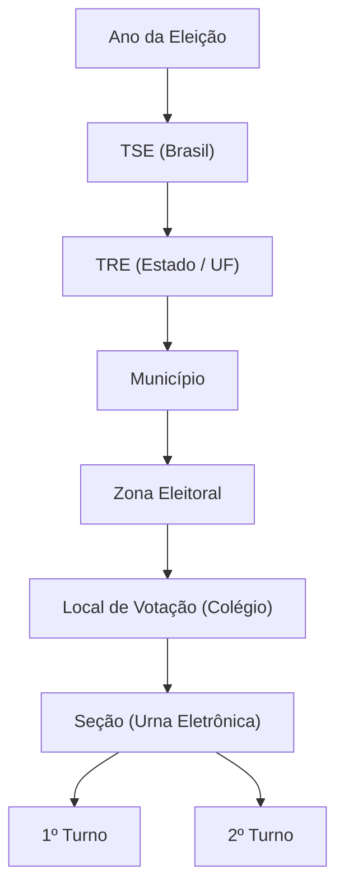

# 🗳️ Painel de Resultados das Eleições

Aplicação web interativa para consulta detalhada, comparação e análise visual dos resultados eleitorais oficiais do Tribunal Superior Eleitoral (**TSE**), com persistência local em **SQLite**.

---

## 📌 Funcionalidades Principais

- **Consulta Simples Hierárquica:**
  - Seleção por **Ano da Eleição** (ex: 2024, 2022).
  - Filtro em cascata: **TRE (Estado) ➔ Município ➔ Zona Eleitoral ➔ Local de Votação (Colégio) ➔ Seção (Urna)**.
  - Resultados detalhados por turno (**1º Turno** e **2º Turno**).
  - Métricas de votos apurados, abstenção, comparecimento, brancos, nulos e votos válidos.

- **Comparativo entre Seções:**
  - Comparação lado a lado entre duas seções eleitorais distintas.
  - Análise de discrepâncias, diferenças percentuais e desvio de abstenção.

- **Analytics Visuais e Gráficos:**
  - Gráficos de barras interativos com **Recharts** para distribuição e comparação de votos.
  - Identidade visual oficial: paleta verde e amarela nacional, com destaque visual vermelho para o Partido dos Trabalhadores (**PT**).

- **Sincronização Oficial TSE & Cache Local:**
  - Backend integrado consumindo dados abertos da API do TSE.
  - Banco de dados local **SQLite** (`better-sqlite3`) para cache e resposta ultrarrápida após a primeira sincronização.
  - Scripts CLI para sincronização sob demanda por UF.

---

## 🛠️ Tecnologias Utilizadas

- **Frontend:**
  - [React 19](https://react.dev/) + [TypeScript](https://www.typescriptlang.org/)
  - [Vite](https://vite.dev/)
  - [Tailwind CSS v4](https://tailwindcss.com/)
  - [Recharts](https://recharts.org/) (Gráficos e visualizações)
  - [Lucide React](https://lucide.dev/) (Ícones)
- **Backend:**
  - [Node.js](https://nodejs.org/) (ES Modules)
  - [Express](https://expressjs.com/)
  - [better-sqlite3](https://github.com/WiseLibs/better-sqlite3) (SQLite local)
  - [CORS](https://github.com/expressjs/cors)
- **Tooling:**
  - [Concurrently](https://github.com/open-cli-tools/concurrently) (execução paralela de front e back em desenvolvimento)

---

## 🏛️ Estrutura do Voto e Hierarquia

A navegação e a modelagem dos dados seguem estritamente a hierarquia do TSE:



---

## 🚀 Como Executar o Projeto

### Pré-requisitos
- [Node.js](https://nodejs.org/) versão 18 ou superior instalado.
- Gerenciador de pacotes `npm`.

### Instalação

1. Clone o repositório ou navegue até o diretório do projeto:
```bash
git clone https://github.com/seu-usuario/resultado-eleicoes.git
cd resultado-eleicoes
```

2. Instale as dependências:
```bash
npm install
```

### Executando em Modo de Desenvolvimento

Para rodar simultaneamente o servidor backend (`localhost:3001`) e a aplicação web Vite (`localhost:5173`):

```bash
npm run dev
```

Acesse no navegador: **`http://localhost:5173`**

---

## ⚙️ Scripts Disponíveis

| Comando | Descrição |
| :--- | :--- |
| `npm run dev` | Inicia o backend Express e o frontend Vite em paralelo. |
| `npm run server` | Inicia apenas o servidor backend com SQLite na porta `3001`. |
| `npm run dev:client` | Inicia apenas o servidor de desenvolvimento do Vite. |
| `npm run sync` | Executa o script CLI de sincronização do TSE para todas as UFs. |
| `npm run sync:sp` | Executa a sincronização do TSE especificamente para o estado de São Paulo (`SP`). |
| `npm run build` | Compila o TypeScript e gera o build de produção via Vite na pasta `dist/`. |
| `npm run preview` | Executa a pré-visualização local do build de produção. |

---

## 📂 Estrutura de Pastas

```text
resultado-eleicoes/
├── public/                 # Arquivos estáticos
├── server/                 # Backend Node.js + Express
│   ├── database.js         # Configuração e tabelas do SQLite (better-sqlite3)
│   ├── index.js            # Endpoints da API REST
│   ├── sync-cli.js         # Script CLI para disparar sincronização com TSE
│   └── tseSync.js          # Lógica de integração e extração dos dados do TSE
├── src/                    # Frontend React + TypeScript
│   ├── assets/             # Imagens e logotipos
│   ├── components/         # Componentes modulares de UI e gráficos
│   │   ├── ComparativoAnalytics.tsx
│   │   ├── ComparativoPage.tsx
│   │   ├── FilterSelector.tsx
│   │   ├── SecaoSelector.tsx
│   │   ├── TurnoAnalytics.tsx
│   │   └── TurnoCard.tsx
│   ├── data/               # Mocks e dados auxiliares
│   ├── services/           # Comunicação com a API backend (electionService)
│   ├── types/              # Tipagens TypeScript da eleição
│   ├── App.tsx             # Componente raiz e controle de navegação
│   ├── index.css           # Estilos globais e Tailwind CSS
│   └── main.tsx            # Ponto de entrada do React
├── agents.md               # Diretrizes de desenvolvimento e arquitetura
├── eleicoes.db             # Banco de dados local SQLite
├── package.json            # Dependências e scripts
├── tsconfig.json           # Configurações TypeScript
└── vite.config.ts          # Configuração do Vite
```

---

## 📖 Documentação e Fontes Oficiais

- [TSE - Informações Técnicas sobre a Divulgação de Resultados](https://www.tse.jus.br/eleicoes/informacoes-tecnicas-sobre-a-divulgacao-de-resultados)
- [Divulgação de Candidaturas e Contas Eleitorais](https://divulgacandcontas.tse.jus.br/)

---

## 📄 Licença

Este projeto é de caráter informativo e educacional para visualização de dados públicos das eleições brasileiras.
