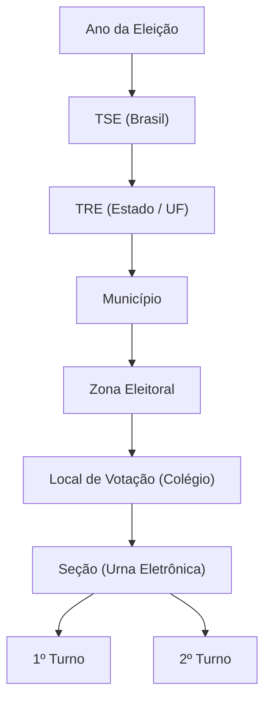

# 🗳️ Painel de Resultados das Eleições

<p align="center">
  
  
  
  
  
  
  
</p>

Aplicação web interativa para consulta, auditoria e comparação dos resultados eleitorais oficiais do Tribunal Superior Eleitoral (**TSE**), com persistência local em **SQLite** para máxima velocidade de resposta.

---

## 📌 Funcionalidades

### 🔍 Consulta Simples em Cascata
- Seleção por **Ano da Eleição** (ex: 2024, 2022).
- Navegação hierárquica completa:
  - **TSE (Brasil) ➔ TRE (Estado) ➔ Município ➔ Zona Eleitoral ➔ Local de Votação (Colégio) ➔ Seção (Urna Eletrônica)**.
- Resultados discriminados por turno (**1º Turno** e **2º Turno**).
- Métricas consolidadas:
  - Total de votos apurados, abstenção e comparecimento.
  - Votos nominais, brancos e nulos.

### ⚖️ Comparativo entre Seções
- Seleção e confronto direto entre duas seções eleitorais distintas.
- Visualização lado a lado de distribuição percentual de votos por candidato.
- Cálculo de discrepâncias e variação na taxa de abstenção.

### 📊 Analytics & Visualização
- Gráficos interativos construídos com **Recharts**.
- Identidade visual temática brasileira (verde e amarelo), com destaque visual em vermelho para o Partido dos Trabalhadores (**PT**).

### ⚡ Sincronização TSE & Cache Local
- Sincronização automática e sob demanda da API pública do TSE.
- Persistência e cache em banco local **SQLite** (`better-sqlite3`), reduzindo latência e evitando bloqueios por requisições repetidas.
- Scripts de sincronização via terminal por estado (UF).

---

## 🏛️ Hierarquia e Estrutura do Voto



---

## 🛠️ Tecnologias

- **Frontend:**
  - [React 19](https://react.dev/) + [TypeScript](https://www.typescriptlang.org/)
  - [Vite](https://vite.dev/)
  - [Tailwind CSS v4](https://tailwindcss.com/)
  - [Recharts](https://recharts.org/)
  - [Lucide React](https://lucide.dev/)
- **Backend:**
  - [Node.js](https://nodejs.org/) (ES Modules)
  - [Express](https://expressjs.com/)
  - [better-sqlite3](https://github.com/WiseLibs/better-sqlite3)
- **Ferramentas:**
  - [Concurrently](https://github.com/open-cli-tools/concurrently)

---

## 🚀 Como Executar

### Pré-requisitos
- [Node.js](https://nodejs.org/) (versão 18 ou superior)
- Gerenciador de pacotes `npm`

### Instalação

```bash
# 1. Clonar o repositório
git clone https://github.com/diegomachado7/resultado-eleicoes.git

# 2. Entrar na pasta do projeto
cd resultado-eleicoes

# 3. Instalar as dependências
npm install
```

### Executar em Desenvolvimento

Para rodar o backend Express e a aplicação web Vite juntos:

```bash
npm run dev
```

Abra no navegador: **[http://localhost:5173](http://localhost:5173)**  
A API REST estará rodando em: **`http://localhost:3001`**

---

## 📜 Scripts Disponíveis

| Comando | Descrição |
| :--- | :--- |
| `npm run dev` | Inicia o backend Express (`:3001`) e o frontend Vite (`:5173`) em paralelo. |
| `npm run server` | Inicia somente o servidor backend Express com SQLite. |
| `npm run dev:client` | Inicia somente o servidor de desenvolvimento do frontend Vite. |
| `npm run sync` | Sincroniza dados oficiais do TSE via CLI para a base local. |
| `npm run sync:sp` | Sincroniza dados eleitorais oficiais de São Paulo (`SP`). |
| `npm run build` | Valida tipagens com `tsc` e gera build otimizado para produção. |
| `npm run preview` | Pré-visualiza localmente a versão de produção gerada na pasta `dist/`. |

---

## 📁 Estrutura de Diretórios

```text
resultado-eleicoes/
├── server/                 # Backend Express & Banco SQLite
│   ├── database.js         # Schema e inicialização das tabelas SQLite
│   ├── index.js            # Endpoints REST da API
│   ├── sync-cli.js         # Script CLI para disparar sincronização com TSE
│   └── tseSync.js          # Consumo dos dados abertos do TSE
├── src/                    # Frontend React + TypeScript
│   ├── assets/             # Recursos estáticos e imagens
│   ├── components/         # Componentes de interface e gráficos
│   │   ├── ComparativoAnalytics.tsx
│   │   ├── ComparativoPage.tsx
│   │   ├── FilterSelector.tsx
│   │   ├── SecaoSelector.tsx
│   │   ├── TurnoAnalytics.tsx
│   │   └── TurnoCard.tsx
│   ├── data/               # Mocks e dados iniciais
│   ├── services/           # Comunicação com a API (electionService)
│   ├── types/              # Tipos TypeScript
│   ├── App.tsx             # Componente raiz e navegação
│   └── main.tsx            # Ponto de entrada React
├── eleicoes.db             # Banco de dados local SQLite
├── package.json
└── vite.config.ts
```

---

## 🌐 Documentação Oficial TSE

- [TSE - Informações Técnicas sobre Divulgação de Resultados](https://www.tse.jus.br/eleicoes/informacoes-tecnicas-sobre-a-divulgacao-de-resultados)
- [Divulgação de Candidaturas e Contas Eleitorais](https://divulgacandcontas.tse.jus.br/)

---

## 📄 Licença

Distribuído sob a licença MIT. Consulte `LICENSE` para mais informações.
